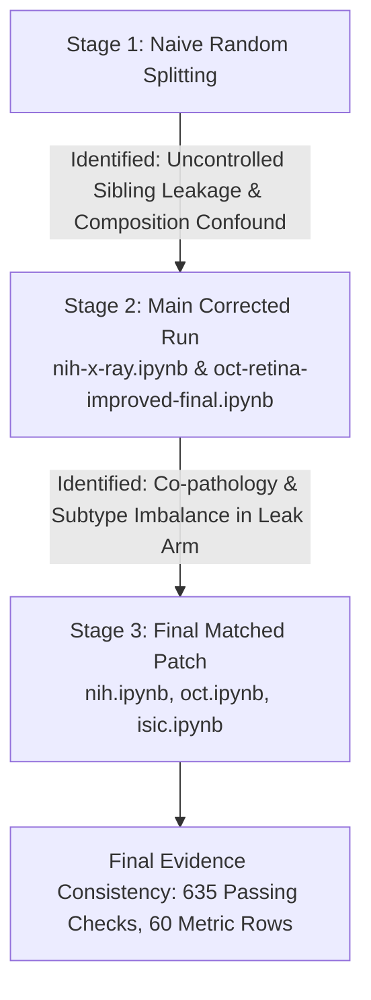

# Protocol Provenance & Retrospective Correction History

This document details the provenance stages of the experimental code and notebooks, directly mapping to **Supplementary Table S13** and **Section 4.1 (Threats to Validity)** of the manuscript:
> *"Same-patient exposure in medical image evaluation: a reporting framework and matched-replacement audit across three modalities."*

---

## 1. Provenance Architecture: Final vs. Earlier Notebooks

The repository distinguishes between **three final executed notebooks** (in `notebooks/final/`) and **two earlier provenance notebooks** (in `notebooks/provenance/`):

| Modality | Final Execution Notebook (`notebooks/final/`) | Earlier Provenance Notebook (`notebooks/provenance/`) | Primary Outputs (`results/`) |
| :--- | :--- | :--- | :--- |
| **SIIM-ISIC 2020** | `isic.ipynb` | *N/A (Standalone One-Run)* | `results/isic/` |
| **NIH ChestX-ray14** | `nih.ipynb` | `nih-x-ray.ipynb` | `results/nih/` |
| **Kermany OCT2017** | `oct.ipynb` | `oct-retina-improved-final.ipynb` | `results/oct/` |

---

## 2. Provenance Progression (Mapping to Supplementary Table S13)

The experimental audit evolved across three distinct stages to systematically eliminate methodological confounds:



### Stage 1: Preliminary & Naive Implementations
- **Characteristics:** Standard image-level random splits commonly found in benchmark literature.
- **Identified Flaws:** Sibling radiographs and retinal B-scans from the same patient spanned training and test partitions. Identical or near-identical image duplicates inflated baseline accuracy.

### Stage 2: Main Corrected Protocol (`notebooks/provenance/`)
- **Implemented in:** `nih-x-ray.ipynb` and `oct-retina-improved-final.ipynb`.
- **Methodological Fixes:**
  - Frozen, audited primary cohorts established: 6,000 images (NIH) and 1,200 images (OCT).
  - Common-test-fold design: rigorous and leaky arms evaluated on **identical fixed test images**.
  - Rigorous arm enforces **0 train/test patient overlap**.
  - Decoded-pixel fingerprinting used to exclude duplicate images.
  - Separate, patient-disjoint validation sets established.
- **Residual Limitations Identified:**
  1. *Binary-only matching confound in NIH:* Matching solely on "Pleural Effusion" allowed the "Effusion absent" negative class to be confounded by non-effusion findings (e.g., Pneumothorax, Infiltration) or differing view positions (AP vs. PA).
  2. *Subtype imbalance in OCT:* Binary disease-vs-normal matching did not equalize pathology proportions among CNV, DME, and DRUSEN.
  3. *Operating threshold:* Evaluation used an uncalibrated fixed 0.5 threshold rather than validation-locked thresholds.

### Stage 3: Final Matched-Replacement Patch (`notebooks/final/`)
- **Implemented in:** `nih.ipynb`, `oct.ipynb`, and `isic.ipynb`.
- **Enhancements:**
  1. **NIH ChestX-ray14 (`nih.ipynb`):**
     - Matches replacements on the **entire normalized 14-disease Finding Labels profile + AP/PA View Position**.
     - Secondary greedy demographic matching (age, sex) audited.
     - Validation-locked Youden's $J$ thresholding selected on validation predictions before test scoring.
     - Strict deterministic execution (`torch.use_deterministic_algorithms(True)`, `cudnn.deterministic=True`).
     - Corrected Grad-CAM quantifying paired map similarity (cosine, Pearson $r$) and centroid displacement on a preselected 600-image OOF subset.
  2. **Kermany OCT2017 (`oct.ipynb`):**
     - Exact 4-way pathology subtype matching (`NORMAL ↔ NORMAL`, `CNV ↔ CNV`, `DME ↔ DME`, `DRUSEN ↔ DRUSEN`).
     - Strict deterministic rerun of paired ResNet-50 and ConvNeXt-Tiny architectures.
     - Corrected border-activation ratio (BR) analysis across all 1,200 test images.
  3. **SIIM-ISIC 2020 (`isic.ipynb`):**
     - Engineered as a standalone, self-contained one-run notebook.
     - Incorporates exact matching on target + diagnosis + anatomical site + sex with nearest-age replacement.
     - Decoded-pixel deduplication (1,168 candidates filtered to 1,162 unique cases).
     - Full sibling and lesion-level exposure audit with cluster bootstrap CIs.

---

## 3. Why Old Checkpoints & Predictions Were NOT Reused

To maintain rigorous scientific reproducibility, all final patch runs strictly enforced the following:
- **No old model predictions reused:** All predictions in `results/` were newly regenerated under deterministic settings.
- **No old model checkpoints reused:** Models were trained from scratch from ImageNet initialization to ensure weights reflect only the audited training sets.
- **Validation-locked operating points:** Decision thresholds were determined strictly on patient-disjoint validation sets and locked prior to evaluating test folds.

Every final run generated a `final_integrity_summary.json` containing programmatic assertions confirming these policies:
```json
{
  "standalone_run": true,
  "old_predictions_reused": false,
  "old_checkpoints_reused": false,
  "all_rigorous_patient_overlap_zero": true,
  "all_rawhash_overlap_zero": true,
  "all_decoded_overlap_zero": true
}
```

---

## 4. Relationship to Manuscript Threats to Validity (Section 4.1)

The retrospective nature of these corrections is explicitly acknowledged in the manuscript:
> *"Protocol correction was retrospective and informed by earlier results. Supplementary Table S13 records documented provenance stages and unavailable change-history details. It is not a complete dated correction chronology or a comparable pre-correction result series."* (Section 4.1, Internal Validity)

Retaining both earlier notebooks and the final patch notebooks in this structured repository provides reviewers and readers with full transparency into how the controlled-exposure framework was refined.
